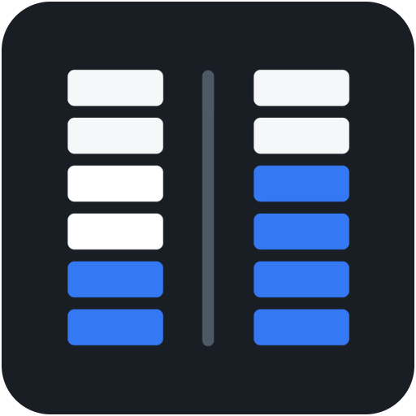
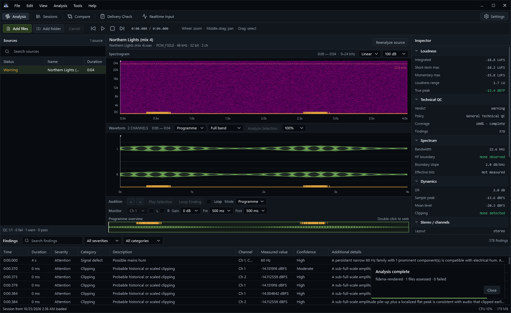

  

<h1 align="center">Revelis</h1>

<strong>Audio Quality Analyzer for Windows</strong>

Measure, compare and verify audio — with the evidence behind every result.

  <a href="https://github.com/Arctisoft-Studio/Revelis-Audio-Quality-Analyzer/releases/latest"><strong>Download</strong></a> ·
  <a href="https://arctisoft-studio.com/software/revelis/">Product website</a> ·
  <a href="https://arctisoft-studio.com/pricing/">Editions &amp; pricing</a> ·
  <a href="https://github.com/Arctisoft-Studio/Revelis-Audio-Quality-Analyzer/releases">Release notes</a> ·
  <a href="https://arctisoft-studio.com/support/">Support</a>

 

The Analysis workspace: spectrogram, waveform and program overview, the measurement inspector and timestamped findings. More views in the <a href="https://arctisoft-studio.com/software/revelis/">product gallery</a>.

Revelis is the audio measurement workstation of Arctisoft Studio. Analyze files, folders and live input; inspect loudness, peaks, dynamics, spectrum and stereo behavior; compare two masters; and check a delivery against a named specification. Measurements, technical findings and delivery verdicts are kept separate, and each states its coverage and limits, so you can see exactly what a result establishes.

## Capabilities

- **Measurement.** Integrated, short-term and momentary loudness, loudness range, sample and true peak, dynamics, stereo correlation and multichannel loudness for declared speaker layouts.
- **Findings with evidence.** Clipping, inter-sample overs, discontinuities, clicks, silence, bandwidth and bit-depth indicators, each with time, channel, measured value and confidence, linked to its position in the waveform and spectrogram.
- **Coverage you can trust.** Quick Scan measures representative regions, Deep Scan the whole program; the report records what was actually measured, and failed or incomplete decoding is never presented as clean.
- **Compare.** Two sources through the same measurement pipeline, with offset and gain alignment, drift and polarity checks, and codec preview of AAC, MP3 and Opus.
- **Delivery Check.** Verify a master against EBU R 128, ATSC A/85, AES TD1008, Free TV OP-59, Spotify, Netflix, Apple Podcasts or your own house and client specifications — one file or a whole folder — with PDF delivery certificates.
- **Live and in the DAW.** Realtime input metering with history and markers, and a VST3 companion that measures a bus inside your DAW and hands the session to Revelis.
- **Formats beyond PCM.** Native DSD (DSF and DSDIFF), high sample rates, multichannel sources and ADM program rendering to stereo, 5.1, 7.1, 5.1.4 and 7.1.4.
- **Records and automation.** Sessions and history, reports in HTML, CSV, JSON and text, SHA-256 archive manifests for later integrity checks, watch folders and a command line with exit codes for pipelines.

A spectrum or bit-pattern observation does not prove a file's original source, lossless ancestry or perceived quality. A delivery result records the requirements that were checked; it does not guarantee acceptance by a distributor or broadcaster.

## Editions

Every measurement, detector, finding and verdict is identical in both editions — a measurement is never more or less correct because of the edition. Premium adds the delivery and studio workflows around it: results that leave Revelis and checks that run without you. Every Premium workflow is visible in Basic and explains itself at the step where it starts.

| | Basic · free | Premium |
| --- | :---: | :---: |
| File and folder analysis, every detector and finding | ✓ | ✓ |
| Waveform, spectrum, spectrogram and audition | ✓ | ✓ |
| Realtime metering and multichannel input | ✓ | ✓ |
| Compare two files, sessions and history | ✓ | ✓ |
| Delivery Check against EBU R 128, ATSC A/85 and AES TD1008 | ✓ | ✓ |
| Service and broadcaster targets (Free TV OP-59, Spotify, Netflix, Apple Podcasts) | Requirements shown | ✓ |
| Your own delivery targets | — | ✓ |
| Folder delivery check with one verdict for the set | One master at a time | ✓ |
| PDF delivery certificates | — | ✓ |
| Report files | On screen, copy as text | HTML, CSV, JSON, text |
| Realtime and companion session export | Shown live | JSON, CSV |
| Codec preview (AAC, MP3, Opus) | — | ✓ |
| VST3 companion and ADM program rendering | — | ✓ |
| Watch folders and archive integrity manifests | — | ✓ |
| Command line with custom policies and exit codes | — | ✓ |

Premium is a one-time purchase for one person, covering the licensed major version and all updates within it, on up to three computers at a time; a licensed computer keeps working offline for 30 days. A 14-day trial is available once per account and computer. See [current pricing](https://arctisoft-studio.com/pricing/); **Help > License** shows the state of this computer.

## System requirements

| | |
| --- | --- |
| Operating system | Windows 10 or Windows 11, 64-bit (x64) |
| Runtime | Included with the installer |
| Installation | For your Windows user account; administrator rights are not required |
| Decoder | FFmpeg, downloaded and kept current by Revelis on first use |
| Plug-ins | A VST3 host, for the Revelis companion |
| Internet | For the decoder download, sign-in, licensing and updates; analysis works offline |

Revelis probes and decodes the actual media rather than trusting the file extension. Common PCM, lossless and lossy formats, multichannel WAV/RF64/BW64 and native DSD are supported; a damaged or unusual file is reported with the reason it could not be measured completely.

## Installation and updates

1. Download `v<version>-revelis.exe` from the [latest release](https://github.com/Arctisoft-Studio/Revelis-Audio-Quality-Analyzer/releases/latest).
2. Run the installer and accept the license agreement. Setup can also install [Arctisoft Studio Hub](https://github.com/Arctisoft-Studio/Arctisoft-Studio-Hub).
3. Start Revelis. Sign in through Studio Hub when you want Premium or the trial.

Revelis checks this repository for updates on the Stable or Preview channel you choose, and installs a new version only after verifying it against the SHA-256 checksum GitHub publishes for the release. Studio Hub can install and update the whole Arctisoft collection from one place.

## Accounts and privacy

Audio is analyzed on your computer and is never uploaded for measurement. Local inspection does not require an account; signing in through Studio Hub enables Premium, the trial and optional synchronization of settings and report metadata. The decoder is downloaded from GitHub, and optional Content Credentials (C2PA) verification uses a pinned verifier and trust list. The [Privacy Policy](https://arctisoft-studio.com/legal/privacy/) describes the account and license data involved.

## Support

Open the user guide from **Help**, visit [Arctisoft Support](https://arctisoft-studio.com/support/) or write to [support@arctisoft-studio.com](mailto:support@arctisoft-studio.com). Report reproducible problems and suggest improvements through [GitHub Issues](https://github.com/Arctisoft-Studio/Revelis-Audio-Quality-Analyzer/issues). Please keep license keys, account details and private audio out of public reports.

## License

Revelis is proprietary commercial software. This repository holds its public documentation and official releases; the source code is not published. Use is governed by the [Revelis EULA](LICENSE), the [Arctisoft Studio License Agreement](https://arctisoft-studio.com/legal/license/) and the [Terms of Service](https://arctisoft-studio.com/legal/terms/). Third-party components, including FFmpeg, keep their own licenses and are listed in the third-party notices installed with Revelis. VST is a registered trademark of Steinberg Media Technologies GmbH.

---

© 2025–2026 Arctisoft Studio. All rights reserved.

